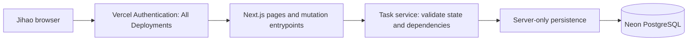
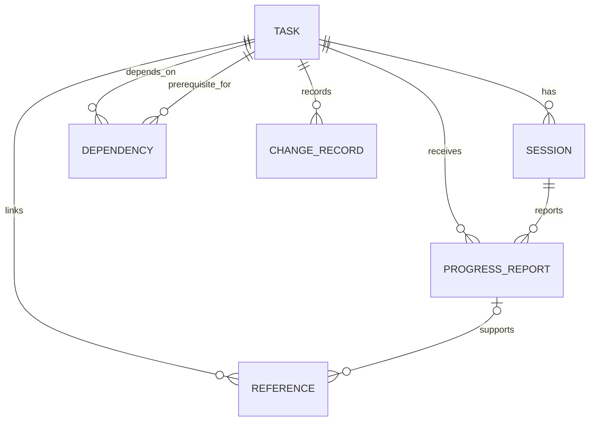

# M1 architecture

2026-09-25 · confirmed M1 baseline (D17–D21) · implementation not started

Confirmed inputs: Next.js + TypeScript; Vercel Hobby; Vercel Authentication for All Deployments; one private user; manual daily-task entry; resumption first. Neon Free Postgres is selected; see [comparison and rationale](DATABASE.md). The user confirmed the recommendations after the alternatives discussion. Exact schema/tooling and operational details remain to specify. Scaffolding, provisioning, and deployment await the separate start instruction (D22).

## Shape and alternatives

Use a **modular monolith**: one deployed app with separate UI, task-rule, and persistence code. Separate services would introduce network coordination and deployment overhead for a flow that needs one transaction. Keep task rules independent of React and of the database driver; do not build a general module framework yet.

Use App Router, server-rendered reads, and Server Actions for browser mutations, all calling a common server-side task service. Alternatives: REST route handlers provide a clear external HTTP API but add endpoint/client plumbing for M1; tRPC shares TypeScript API types but adds a framework; GraphQL's query flexibility is unnecessary here. Future MCP/HTTP adapters can call the same task service without duplicating completion rules. Server Actions must be treated as externally callable mutation endpoints, with validation and access checks; they are not private merely because they live in server files. [Next.js data security](https://nextjs.org/docs/app/guides/data-security).



No browser database SDK, public database key, background job, cron, or ChatGPT API integration in M1. Manually capture the chosen generated task, its date/source reference, outcome, and entry action. Source date is provenance only. Publishing and calendar adapters remain future work.

## Logical model for implementation

Exact columns, constraints, and migrations are reviewed during implementation planning; these records guide implementation; no schema has been installed.

| Record | Key fields / purpose |
| --- | --- |
| Task | Stable ID; title; observable outcome; source/date/reference; status; next action; stopping note; revision; timestamps. |
| Session | ID; task ID; optional start time; intended stopping point; optional close time; outcome; revision. A skip before start has no fabricated start time. |
| Progress report | ID; task/session IDs; source/actor; reported and recorded timestamps; result; progress/blocker; next action; outcome-achieved assertion for done; optional superseded-report ID. |
| Reference | ID; task ID; optional report ID; URL or descriptive reference; provenance and confidence. No uploads needed. |
| Dependency | Task ID; prerequisite task ID. Reject self-links and cycles. Eligibility is derived from current prerequisite completion, not a stored calendar flag. |
| Change record | Entity ID; change type; timestamp; actor/source; prior and new revision or values. Records task edits and report corrections. |
| Mutation receipt | Unique request ID; payload fingerprint; resulting record IDs. Makes retries return the original committed result. |



Saved questions belong to the broader first release and are deferred from M1. A single fixed private owner is sufficient in this draft; do not pretend that this is a tested multi-tenant model.

## State behavior to implement and verify

Task states: not started, in progress, blocked, done. Treat deliberate pause/archive as selection/visibility metadata rather than completion. Session execution phase and reported outcome are separate: a started but unreported session does not imply partial work. UI can show unresolved sessions without inventing an end time or elapsed-time result.

| User action | Required effect |
| --- | --- |
| Select generated task | Create/select a stable task; explicit selection acknowledges the proposal. A repeated save of the same request returns the same task ID. Similar text alone is not a reliable deduplication key. |
| Start | Create a session on the existing task; do not claim progress until reported. Recheck dependencies. |
| Report partial | Save stopping note and next action; close the session; task becomes/remains in progress. |
| Skip / not started | Record the session outcome; preserve task status, prior progress, stopping note, and next action. |
| Report blocker | Save blocker; task becomes blocked. Offer an unblock step or pause; dependent implementation remains unavailable. |
| Report done | Require explicit confirmation that the stored observable outcome was achieved and reported; retain self-report provenance. Do not require external evidence for every task. |
| Resume | Display saved context and create another session for the same task. A blocked task requires choosing an unblock action before starting. |
| Correct report | Append a correction referencing the old report; update affected current state atomically and re-evaluate eligibility without erasing dependent work. |
| Ignore / leave app | Preserve task status and unresolved session. Do not infer completion, distraction, or abandonment. |

Concurrency baseline: at most one active session per task; a second start returns that session or prompts reconciliation. Resuming with unresolved feedback requires explicit pause/leave-unreported or a report, not fabricated work. Corrections to older reports must not overwrite later progress blindly: show the resulting current-state change for confirmation and reject stale edits by revision.

## Atomic writes and retry behavior

A report command validates inputs, checks the expected revision, verifies the session belongs to the task, validates prerequisites where applicable, writes report/history, updates session/task, and stores the mutation receipt in one transaction. Use the same request ID when retrying after a lost response; identical payload returns the original result and differing payload with the same ID is rejected.

Check the receipt before rejecting a revision mismatch so a retry of an already-successful command can return success. Protect validation plus updates with appropriate transaction isolation/locks, including prerequisite rows when eligibility matters. Acquire locks in stable order; retry serialization/deadlock failures only with the same request identity and a bounded policy. [Postgres locking](https://www.postgresql.org/docs/current/explicit-locking.html).

```mermaid
sequenceDiagram
    participant B as Browser
    participant S as Task service
    participant D as Postgres
    B->>S: Partial report + task revision + request ID
    S->>D: Begin transaction; check receipt and current state
    S->>D: Save report, session result, next action, history, receipt
    D-->>S: Commit
    S-->>B: Saved state and same task ID
    B->>S: Resume after reopening
    S->>D: Read current task and stopping context
    D-->>S: Existing task, next action, history
    S-->>B: Render resumption context
```

Show success only after commit. On timeout, explain that save status is uncertain and retry safely; preserve the entered form in the current page. Offline durable drafts are not promised by M1. Never treat a storage error as an empty task list. Read current state on reopen and after mutations; avoid serving stale cached completion as authority.

## Access and privacy boundary

Confirmed: Vercel Authentication with All Deployments, including production and previews. M1 baseline: sole-user project access, no public exceptions, no share/bypass links, and no additional application login system. This is a platform-enforced private deployment, not an application identity/roles system. Expanding project membership changes who can reach the app and requires review.

The server checks the expected deployment configuration operationally before exposure; do not trust arbitrary browser-supplied identity headers. All data reads and mutations remain behind the same boundary. Use same-origin mutation protections, server validation, parameterized queries, bounded input, escaped text rendering, and safe reference URLs. Do not fetch user-supplied URLs server-side in M1. Keep private responses out of public caches and task text/secrets out of logs. The Next.js security guide informs these controls; validate behavior against the exact pinned version before implementing.

Database credentials are server-only; use a restricted runtime role separate from migrations. Deployment authentication does not protect a database endpoint or grant database identity. See DATABASE.md for conditional Supabase RLS requirements. Production credentials/data never enter previews, development, or PR CI.

Test access while signed out and with an unauthorized account across production aliases, deployment URLs, preview URLs, reads, and mutations. Verify direct database access without credentials fails. Local development uses synthetic data and localhost only. Do not promote real data until these checks pass.

## Environments, changes, and recovery

Use separate production and synthetic nonproduction database projects; preview branches originate only from synthetic data. No automatic copy of production rows. App runtime uses connection pooling suitable for the selected provider/driver; transactions must stay on the same connection. Select and verify package versions and exact driver/migration tooling at implementation kickoff, before installing them; Neon is already selected.

Version schema changes in Git; apply them to test storage before production. M1 migrations should be additive where possible. Take a recovery export before a production migration and test compatibility with the current app. On failed migration, halt promotion; rollback code only if the database remains compatible, otherwise apply a reviewed forward fix or restore to an isolated target. Never run destructive reset against production.

The confirmed bounded-trial backup approach (D21) is user-triggered exports after actual-use days and before migrations, encrypted outside Git/provider, with one rehearsed restore before reliance. Changes since the last successful export can be lost. Destination, retention, and encryption/key handling remain to specify before real-data use; see DATABASE.md. Review automated backups before ongoing daily reliance. No automation has been authorized or created.

## Verification and operations

- Pure state tests: partial, skipped before start, skipped after partial, unknown, blocker, completion against outcome, correction, and dependency invalidation.
- Postgres integration tests: atomic rollback, duplicate request, same key/different payload, stale revision, concurrent starts/reports, dependency race, and preserving IDs through restore. Use the actual chosen Postgres engine with synthetic fixtures.
- Browser checks: manually enter the day's task; choose/start/partial/reopen/resume; skip/reopen/resume same ID; unresolved feedback; visible save failure. Use a representative generated sample until the real task is available, and label it as synthetic.
- Hosted verification: platform-access tests plus the real resumption flow. Production-only credentials stay out of PR CI. Initially record platform checks manually rather than adding protection-bypass secrets to PR jobs.
- CI baseline: typecheck, lint, state/integration tests, and build; browser coverage for the core loop. Framework/tool versions and CI deployment mechanism need a final implementation plan.
- Operational minimum: structured event/error IDs, mutation outcome and latency, no personal report text; visible storage errors and a recovery runbook. No background jobs means no job heartbeat in M1. Define alerts when adding unattended work.

## Evolution

Next.js remains the React frontend if a backend is later extracted. Framework-independent task rules can move behind an HTTP or MCP adapter, though extraction still requires authentication, network-failure handling, and deployment work. A publishing worker is a possible future operational boundary; separate task/report services are not an M1 goal because their writes must remain consistent.

A Neon-to-Supabase move would retain the PostgreSQL engine but change the managed platform. It would still require data migration and verification of versions, extensions, permissions, connections, and any provider-specific integrations. It is not a planned migration or a claim of interchangeability.

See [M1 design summary](M1-IMPLEMENTATION.md) for the selected stack and rationale. The PRD remains the product authority. Exact schema, driver/ORM and migration tooling, deletion/export/privacy details, recovery destination/retention, and the real acceptance task text remain to settle before their affected implementation. No paid service or public-user security design has been approved.
